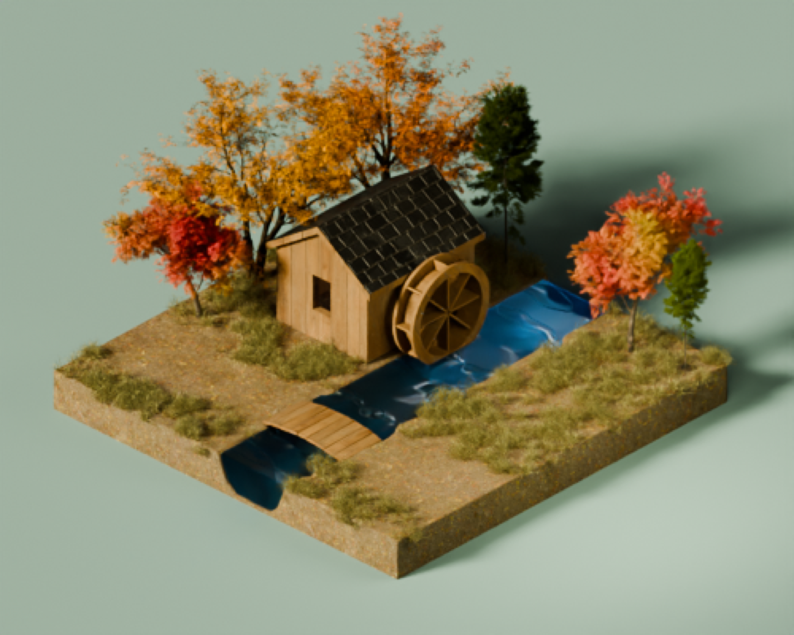

# Mini World - Blender 3D Scene

Isometric 3D diorama with a wooden watermill, river, bridge and forest, made in Blender 4.2.

## Tools and techniques
- Blender 4.2 (Cycles)
- Modeling, materials (Principled BSDF), lighting, vegetation scattering
